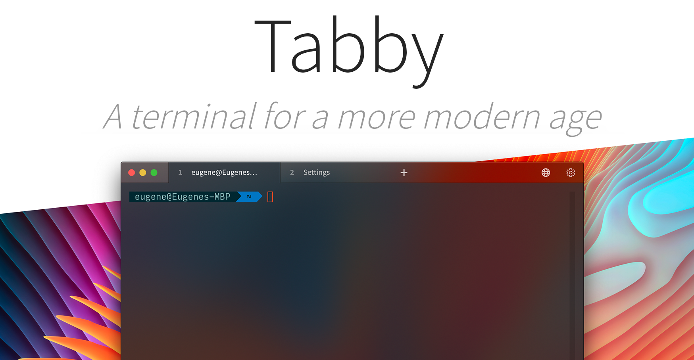
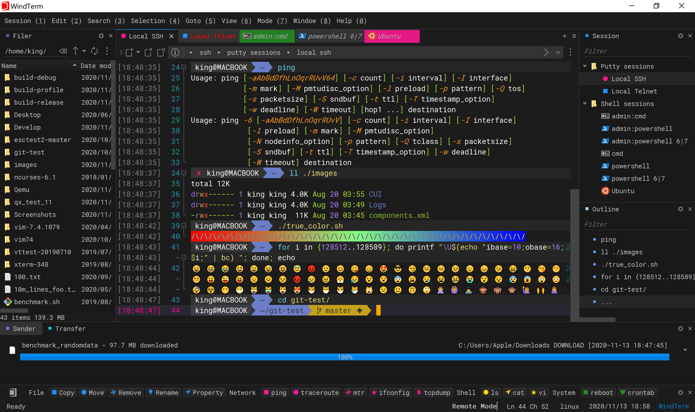
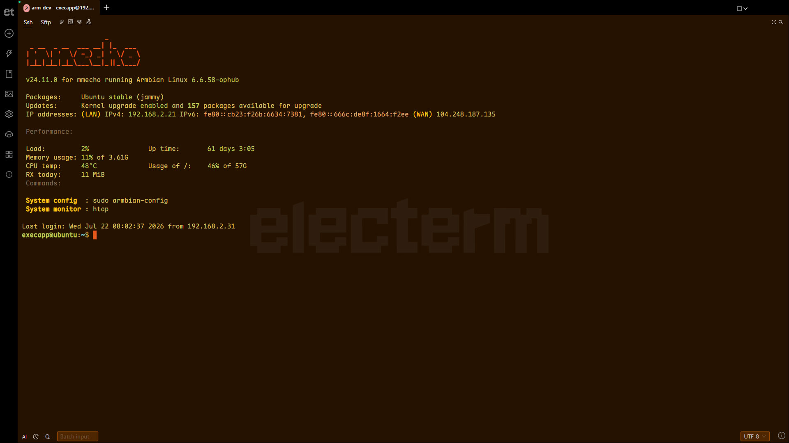
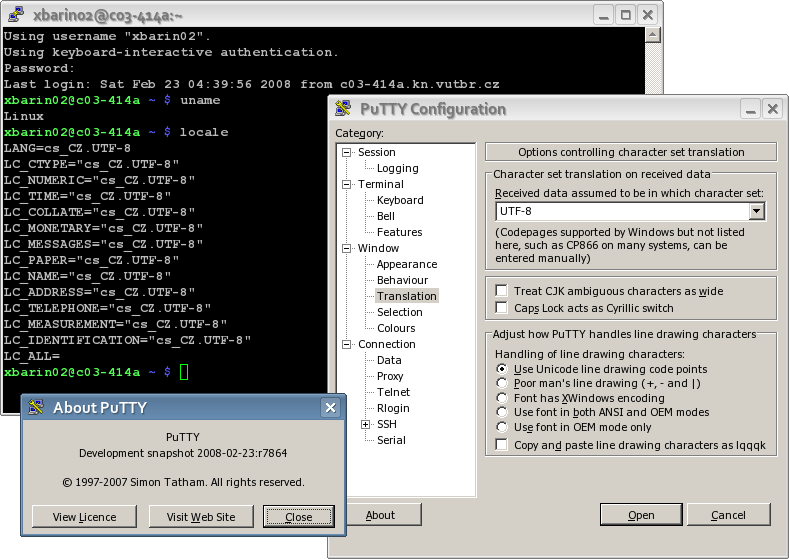
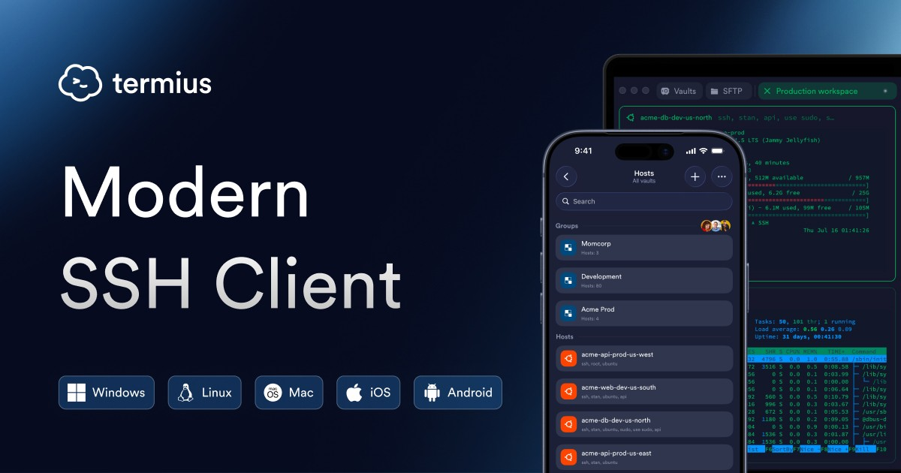
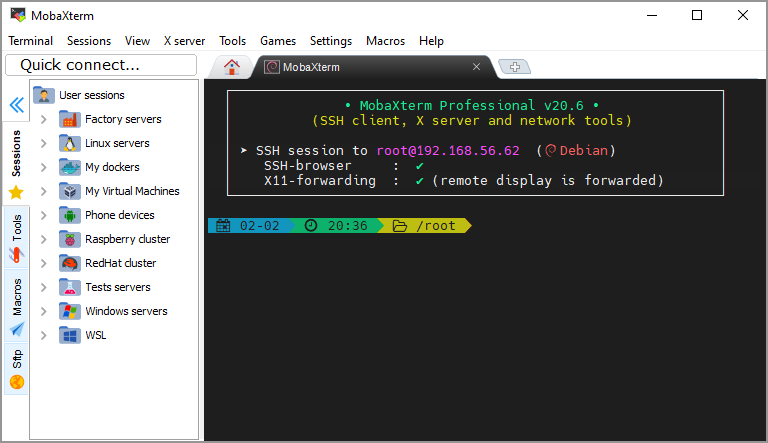
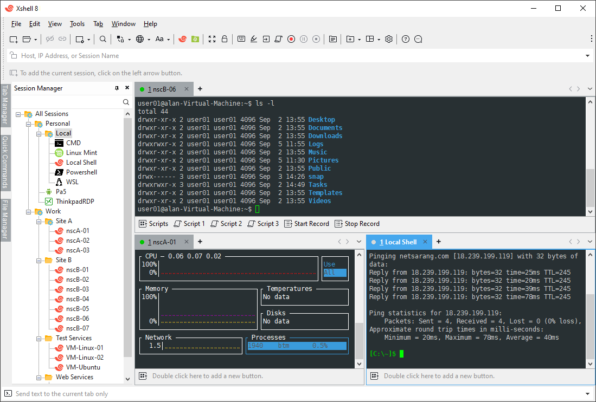
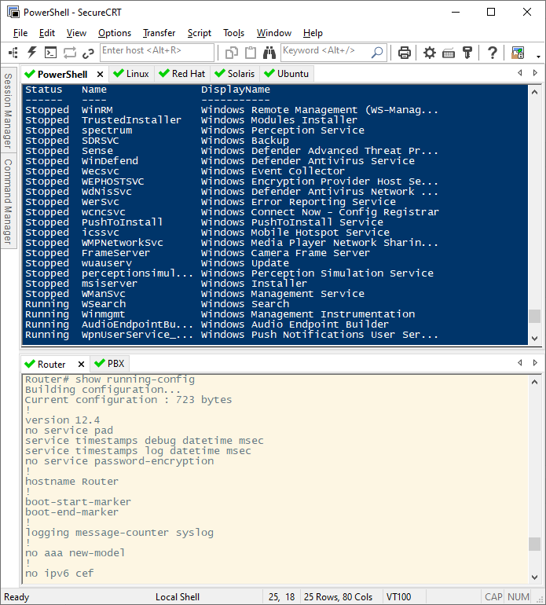
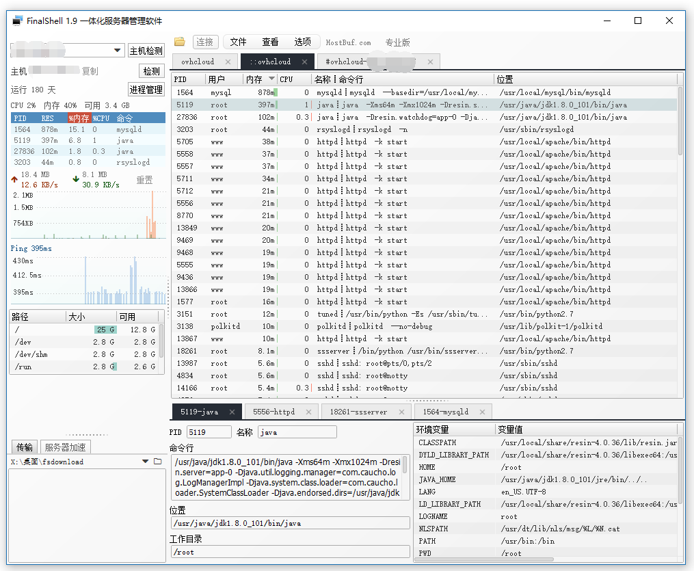
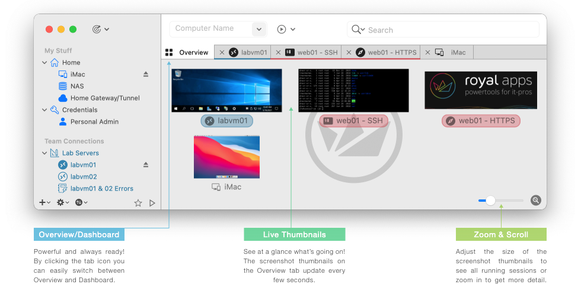

# SSH 客户端怎么选？2026 年 10 款主流工具横评（附选购清单）

> 一句话版本：**个人免费用选 Tabby / WindTerm，多设备选 Termius，Windows 杂活选 MobaXterm，服务器少就直接用系统自带的 `ssh`。**

不管是写代码、搞运维，还是自己折腾一台 VPS，SSH 客户端每天都要打开好几次。工具选对了，连服务器、传文件、开隧道都是顺手的事；选错了，要么卡顿占内存，要么用到一半弹出付费墙。

这篇文章把 2026 年还值得用的 10 款 SSH 客户端放在一起比较，按**免费程度、跨平台、文件传输、同步能力、资源占用**五个维度逐个点评，最后附上 `~/.ssh/config` 实用配置和安全加固清单。

---

## 目录

- [30 秒快速选择](#30-秒快速选择)
- [评测维度说明](#评测维度说明)
- [免费开源派](#免费开源派)
  - [Tabby](#1-tabby)
  - [WindTerm](#2-windterm)
  - [electerm](#3-electerm)
  - [PuTTY](#4-putty)
- [跨设备同步派](#跨设备同步派)
  - [Termius](#5-termius)
- [Windows 专精派](#windows-专精派)
  - [MobaXterm](#6-mobaxterm)
  - [Xshell](#7-xshell)
- [商业 / 进阶派](#商业--进阶派)
  - [SecureCRT](#8-securecrt)
  - [FinalShell](#9-finalshell)
  - [Royal TS / Royal TSX](#10-royal-ts--royal-tsx)
- [零安装：系统自带 OpenSSH](#零安装系统自带-openssh)
- [手机端怎么选](#手机端怎么选)
- [横向对比表](#横向对比表)
- [安全加固清单](#安全加固清单)
- [常见问题 FAQ](#常见问题-faq)

---

## 30 秒快速选择

```
你需要在手机上连服务器吗？
├── 是 ──> Termius（电脑手机统一，同步需订阅）
└── 否
    ├── 只用 Windows，且要 X11 / RDP / 串口？ ──> MobaXterm
    ├── 想要完全免费、跨平台？
    │   ├── 电脑配置一般、追求流畅 ──> WindTerm
    │   ├── 喜欢现代界面、插件生态 ──> Tabby
    │   └── 传文件比敲命令还多 ──> electerm
    ├── 公司采购、要求稳定合规 ──> SecureCRT
    └── 服务器不超过 3 台 ──> 系统自带 ssh + ~/.ssh/config
```

---

## 评测维度说明

| 维度 | 看什么 |
|---|---|
| 💰 免费边界 | 是开源、免费闭源，还是免费版有限制？ |
| 🖥️ 平台 | Windows / macOS / Linux / 移动端 |
| 📁 文件传输 | 有没有内置 SFTP，能不能拖拽上传下载 |
| 🔄 同步 | 主机列表、密钥能否在多台设备间同步 |
| ⚡ 资源占用 | 启动速度、内存占用（Electron 应用普遍偏高） |

---

## 免费开源派

### 1. [Tabby](https://tabby.sh)

| 平台 | 价格 | 协议 |
|---|---|---|
| Windows / macOS / Linux | 免费 | MIT 开源 |

**优点**

- 界面现代，多标签 + 分屏，主题和插件都很丰富
- SSH、Telnet、串口、本地 Shell 集成在一个窗口
- 内置 SFTP 面板，支持跳板机和端口转发

**缺点**

- 基于 Electron，内存占用偏高，老电脑开多个标签会明显变慢

**适合谁**：想要一款长期主力、跨平台、不想花钱的用户。



---

### 2. [WindTerm](https://github.com/kingToolbox/WindTerm)

| 平台 | 价格 | 协议 |
|---|---|---|
| Windows / macOS / Linux | 免费，无商业限制 | 部分开源 |

**优点**

- C/C++ 编写，启动快、渲染快，大量输出滚动也不卡
- 会话管理、端口转发、跳板机、命令片段一应俱全
- 自带 SFTP 和本地文件管理器

**缺点**

- 界面设置项多，刚上手需要花点时间摸索

**适合谁**：受够了 Electron 臃肿、追求极致流畅的开发者和运维。



---

### 3. [electerm](https://electerm.org)

| 平台 | 价格 | 协议 |
|---|---|---|
| Windows / macOS / Linux | 免费 | MIT 开源 |

**优点**

- 国产开源项目，中文界面友好
- 终端与 SFTP 文件管理左右并排，传文件非常直观
- 书签和配置可以通过 GitHub / Gitee Gist、WebDAV 同步

**缺点**

- 同样基于 Electron，资源占用不算低

**适合谁**：经常在本地和服务器之间来回传文件、喜欢中文界面的用户。



---

### 4. [PuTTY](https://www.putty.org)

| 平台 | 价格 | 协议 |
|---|---|---|
| Windows（另有 Unix 版） | 免费 | MIT 开源 |

**优点**

- 体积只有几 MB，绿色免安装，二十多年的老牌稳定工具
- 配套 PuTTYgen（生成密钥）、Pageant（密钥代理）、PSCP/PSFTP（传文件）

**缺点**

- 界面古老，没有多标签，会话管理很原始
- 没有图形化 SFTP

**适合谁**：临时连一下、在别人电脑上应急、或者只要"能用就行"的用户。



---

## 跨设备同步派

### 5. [Termius](https://termius.com)

| 平台 | 价格 | 协议 |
|---|---|---|
| Windows / macOS / Linux / iOS / Android | 免费版 + 订阅 | 闭源 |

**优点**

- 全平台体验统一，手机端是同类中做得最好的
- 主机、密钥、命令片段可端到端加密同步（订阅功能）
- 支持 SFTP、端口转发、团队共享

**缺点**

- 核心卖点"同步"需要付费；数据存在云端，对合规有要求的公司需评估

**适合谁**：电脑、平板、手机都要连服务器，半夜需要拿手机救火的人。



---

## Windows 专精派

### 6. [MobaXterm](https://mobaxterm.mobatek.net)

| 平台 | 价格 | 协议 |
|---|---|---|
| 仅 Windows | 免费 Home 版 / 付费 Pro 版 | 闭源 |

**优点**

- 内置 X Server，远程的图形程序可以直接在本地弹出窗口
- SSH、RDP、VNC、FTP、串口、Mosh 等协议全家桶
- 登录后左侧自动出现 SFTP 文件树，拖拽即可传文件
- 有便携版，U 盘带着走

**缺点**

- Home 版对保存的会话数、隧道数有上限
- 界面信息密度高，略显杂乱

**适合谁**：Windows 用户，需要处理多协议、远程图形程序的高级用户。



---

### 7. [Xshell](https://www.xshell.com)

| 平台 | 价格 | 协议 |
|---|---|---|
| 仅 Windows | 家庭/学校免费，商用付费 | 闭源 |

**优点**

- 界面精致，标签管理、会话分组手感好
- 配合同厂的 Xftp 做文件传输，是国内很多公司的标配
- 中文教程极多，遇到问题容易搜到答案

**缺点**

- 仅限 Windows；商用必须购买授权，公司电脑别随便装免费版

**适合谁**：Windows 用户，习惯传统客户端、看重稳定和中文资料。



---

## 商业 / 进阶派

### 8. [SecureCRT](https://www.vandyke.com/products/securecrt/)

| 平台 | 价格 | 协议 |
|---|---|---|
| Windows / macOS / Linux | 付费（可试用） | 闭源 |

**优点**

- 老牌商业软件，稳定性和兼容性口碑很好，网络设备工程师用得多
- 支持脚本自动化（Python / VBScript 等）、批量发送命令
- 会话管理、串口、Telnet 等功能成熟

**缺点**

- 价格不低，界面偏传统

**适合谁**：企业采购、网络工程师、需要脚本批量操作设备的场景。



---

### 9. [FinalShell](https://www.hostbuf.com)

| 平台 | 价格 | 协议 |
|---|---|---|
| Windows / macOS / Linux | 免费版 + 付费高级版 | 闭源 |

**优点**

- 国产工具，一个窗口集成终端、文件管理、服务器监控（CPU / 内存 / 网速 / 进程）
- 对新手非常友好，VPS 玩家中很流行

**缺点**

- 基于 Java，启动和内存占用偏高
- 闭源软件，对安全性要求高的场景请自行评估

**适合谁**：刚接触 Linux 服务器、希望"连上就能看到服务器状态"的新手。

<!-- 截图待补：把 FinalShell 界面截图命名为 finalshell.png 放进 images/，并在此处加一行  -->

---

### 10. [Royal TS / Royal TSX](https://www.royalapps.com)

| 平台 | 价格 | 协议 |
|---|---|---|
| Windows（Royal TS）/ macOS（Royal TSX）/ 移动端 | 免费版有连接数限制，付费解锁 | 闭源 |

**优点**

- 定位"远程连接管理器"，SSH、RDP、VNC、Web 页面统一管理
- 凭据与连接分离管理，适合团队共享连接文档

**缺点**

- 免费版限制较多；单纯用 SSH 的话功能有点"重"

**适合谁**：需要同时管理大量 SSH + RDP 主机的 IT 管理员。



---

## 零安装：系统自带 OpenSSH

Windows 10/11、macOS、各大 Linux 发行版都内置了 [OpenSSH](https://www.openssh.com) 客户端，打开终端就能用：

```bash
ssh root@1.2.3.4
```

### 用 `~/.ssh/config` 管理主机

主机一多，把它们写进配置文件，之后只需要敲别名：

```sshconfig
# 通用设置：保持连接，防止空闲断开
Host *
    ServerAliveInterval 60
    ServerAliveCountMax 3

# 普通服务器
Host vps
    HostName 1.2.3.4
    User root
    Port 22
    IdentityFile ~/.ssh/id_ed25519

# 通过跳板机连接内网机器
Host internal-db
    HostName 10.0.0.5
    User admin
    ProxyJump vps
```

然后：

```bash
ssh vps
ssh internal-db
```

### 几个常用命令

```bash
# 生成密钥（推荐 ed25519）
ssh-keygen -t ed25519 -C "your_email@example.com"

# 把公钥上传到服务器（Windows 可手动复制到 ~/.ssh/authorized_keys）
ssh-copy-id vps

# 传文件
scp ./app.tar.gz vps:/opt/

# 本地端口转发：把服务器的 3306 映射到本机 13306
ssh -L 13306:127.0.0.1:3306 vps
```

再配合 VS Code 的 **Remote - SSH** 扩展，直接在远程服务器上编辑代码，体验不输任何图形客户端。

---

## 手机端怎么选

| 系统 | 推荐 | 说明 |
|---|---|---|
| iOS / iPadOS | [Termius](https://termius.com) | 免费版足够应急，和桌面端同步需订阅 |
| iOS / iPadOS | [Blink Shell](https://blink.sh) | 付费，支持 Mosh，外接键盘体验极佳 |
| Android | [Termius](https://termius.com) | 同上 |
| Android | [Termux](https://termux.dev) | 免费开源的 Linux 环境，`pkg install openssh` 后即可使用 |

---

## 横向对比表

| 客户端 | 平台 | 价格 | 开源 | SFTP | 同步 | 资源占用 |
|---|---|---|---|---|---|---|
| Tabby | Win / Mac / Linux | 免费 | ✅ | ✅ | ⚠️ 需配置 | 偏高 |
| WindTerm | Win / Mac / Linux | 免费 | 部分 | ✅ | ❌ | 低 |
| electerm | Win / Mac / Linux | 免费 | ✅ | ✅ | ✅ Gist / WebDAV | 偏高 |
| PuTTY | Windows 为主 | 免费 | ✅ | 命令行 | ❌ | 极低 |
| Termius | 全平台 + 移动端 | 免费 / 订阅 | ❌ | ✅ | ✅ 付费 | 中 |
| MobaXterm | Windows | 免费 / 付费 | ❌ | ✅ | ❌ | 中 |
| Xshell | Windows | 家用免费 / 商用付费 | ❌ | 配合 Xftp | ❌ | 低 |
| SecureCRT | Win / Mac / Linux | 付费 | ❌ | ✅ | ❌ | 低 |
| FinalShell | Win / Mac / Linux | 免费 / 付费 | ❌ | ✅ | ❌ | 偏高 |
| Royal TS(X) | Win / Mac / 移动端 | 免费受限 / 付费 | ❌ | ✅ | ✅ 文档共享 | 中 |
| OpenSSH | 全平台 | 免费 | ✅ | `scp` / `sftp` | 配置文件 | 极低 |

---

## 安全加固清单

客户端选哪个都行，**服务器安全比客户端重要得多**。新开一台公网服务器，建议至少做到：

- [ ] 使用 **ed25519 密钥登录**，给私钥设置口令
- [ ] 在 `/etc/ssh/sshd_config` 中关闭密码登录：`PasswordAuthentication no`
- [ ] 禁止 root 直接用密码登录：`PermitRootLogin prohibit-password`
- [ ] 安装 `fail2ban` 等工具，自动封禁暴力破解 IP
- [ ] 定期更新系统和 OpenSSH：`apt update && apt upgrade`
- [ ] 不在客户端里明文保存 root 密码，不把私钥上传到网盘或 Git 仓库
- [ ] 只从**官网或官方仓库**下载客户端，警惕"破解版""绿色汉化版"

> ⚠️ 修改 `sshd_config` 之前，先确认密钥登录可用，并**保留一个已登录的会话**再重启 `sshd`，避免把自己锁在门外。

---

## 常见问题 FAQ

**Q：完全免费、没有任何限制的有哪些？**
A：Tabby、WindTerm、electerm、PuTTY 和系统自带的 OpenSSH。

**Q：Mac 用户推荐什么？**
A：系统终端 + `~/.ssh/config` 就很好用；要图形界面选 Tabby、WindTerm 或 Termius。

**Q：Xshell 公司里能用免费版吗？**
A：不能。免费授权仅限家庭和学校用途，商用需购买许可证。

**Q：为什么连上服务器后过一会儿就断了？**
A：多数是网络中间设备清理了空闲连接。在客户端开启"保持连接 / Keepalive"，或在 `~/.ssh/config` 里加 `ServerAliveInterval 60`。

**Q：SSH 连接很慢，要等好几秒才出现密码提示？**
A：常见原因是服务器端做 DNS 反查，可在 `sshd_config` 中设置 `UseDNS no` 后重启 sshd。

---

## 总结

| 场景 | 推荐 |
|---|---|
| 个人开发、免费跨平台 | **Tabby** 或 **WindTerm** |
| 频繁传文件、喜欢中文 | **electerm** |
| 电脑 + 手机多端使用 | **Termius** |
| Windows 多协议全家桶 | **MobaXterm** |
| 企业采购、脚本自动化 | **SecureCRT** |
| 服务器就几台 | **系统自带 OpenSSH** |

如果这篇文章对你有帮助，欢迎点个 ⭐ Star；发现信息过时或有更好的工具推荐，欢迎提 Issue 或 PR。

---

*文中软件价格与授权政策以各官网最新说明为准；截图来自各产品官网及官方仓库，仅用于介绍说明。*

**关键词**：SSH 客户端推荐、SSH 工具对比、2026 SSH 软件、远程服务器管理、免费 SSH 客户端、Windows SSH 工具、Mac SSH 工具
